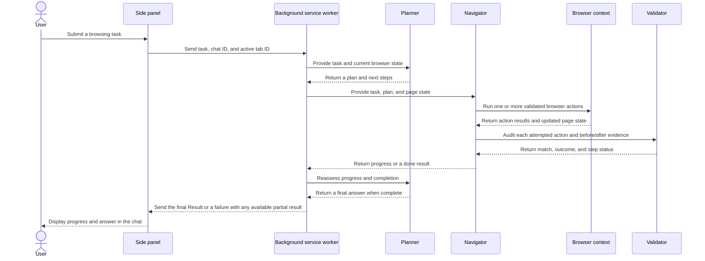

# AutoWeb

AutoWeb is an open-source browser automation extension for Chrome and Microsoft Edge. You give it a task in the side panel; its Planner, Navigator, and Validator agents work with the current browser tab to carry it out and return a result in the chat.

The project is a TypeScript monorepo built with pnpm, Turbo, and Vite. The extension uses Manifest V3, a background service worker, React pages, Chrome extension APIs, Puppeteer Core over the Chrome DevTools Protocol, and LangChain integrations for language models.

> **Status:** This repository builds an unpacked extension and a distribution ZIP. Installation from a public browser extension store is not currently documented here.

## Contents

- [What AutoWeb does](#what-autoweb-does)
- [How a task runs](#how-a-task-runs)
- [The agents](#the-agents)
- [Browser automation and available actions](#browser-automation-and-available-actions)
- [Project structure](#project-structure)
- [Requirements and installation](#requirements-and-installation)
- [Configure models](#configure-models)
- [Use AutoWeb](#use-autoweb)
- [Privacy, permissions, and safety](#privacy-permissions-and-safety)
- [Troubleshooting](#troubleshooting)
- [Development and checks](#development-and-checks)
- [Contributing](#contributing)
- [License](#license)

## What AutoWeb does

- Automates browsing tasks from a chat in the browser side panel.
- Uses separate agents to plan work, interact with pages, and audit actions after they happen.
- Reads page structure and visible interactive elements to decide what to click, type, or inspect.
- Supports follow-up requests in the same chat. Each follow-up starts with a fresh plan and validator context while keeping the current browser tab.
- Stores chat history and extension settings in Chrome extension storage.
- Supports configurable model providers and lets users select Planner and Navigator models separately.
- Provides a permission-based microphone input flow. Transcription currently requires a Gemini provider and a speech-to-text model configured in Settings.
- Offers optional vision, a URL firewall, task replay, bookmarks, and analytics settings.

AutoWeb runs its coordinator and browser automation in the extension. When a cloud model is selected, the task prompt and the browser information needed by that model are sent to that provider. Review the [privacy and safety notes](#privacy-permissions-and-safety) before using the extension with sensitive pages.

## How a task runs



The background `Executor` coordinates this loop. It runs the Planner at the start, at configured intervals, after the Navigator reports completion, and when a validation result asks for a replan. It checks the plan before accepting completion. A Navigator `done` action is a signal to evaluate the task; the Executor still requires the Planner's completion decision and, for web tasks, completed plan steps.

The Validator runs **after** an action. It does not approve or block a proposed action before execution. It separately assesses whether the action matched the current planned step and whether browser evidence supports the outcome. A deviation or unverified result tells the system to review the page and plan again.

## The agents

### Planner

The Planner is responsible for the overall strategy. It decides whether browser interaction is needed, creates an ordered plan with stable step IDs and observable success criteria, reviews the current state, and decides what should happen next. When the task is complete, it creates the user-facing final answer.

For a follow-up, AutoWeb creates a new Executor and plan for that request. It uses the existing chat session and browser tab, but does not carry old task validation state into the new request.

The Planner model is configured under **Settings → Models**. If no separate Planner model is configured, AutoWeb uses the Navigator model for planning as well.

### Navigator

The Navigator turns the plan into browser actions. It receives the user's task, the current plan, recent action results, and a representation of the page. It can carry out multiple compatible actions in a sequence, then stops the sequence when the page changes significantly or an audit requests replanning.

The Navigator returns progress and memory between steps. When it believes the task is complete, it calls the `done` action with the result it has collected. That result is available as a fallback if the Planner does not provide final answer text.

### Validator

The Validator is an independent post-action auditor. It receives the original request, the original and current plans, the action that ran, the action result, and a summary of the browser state before and after the action.

It reports two separate judgments:

- **Operation match:** Did the action correspond to the correct planned step and order?
- **Success verification:** Does the recorded result and browser state support that the action succeeded?

The Validator can mark a step completed, in progress, failed, or in need of revalidation. Its model is the configured Planner model, falling back to the Navigator model when no Planner model is configured. It does not have a separate model selector.

## Browser automation and available actions

The extension background service worker manages a `BrowserContext` for the active tab. The browser layer attaches through Chrome's debugger API and uses Puppeteer Core to inspect and control the tab. A content script and the injected `buildDomTree.js` helper provide page structure used to build the Navigator's browser state and indexed interactive elements.

Actions are defined with Zod schemas and validated before their handlers run. The available action set includes:

- **Navigation:** `go_to_url`, `search_google`, `go_back`, `open_tab`, `switch_tab`, `close_tab`
- **Page interaction:** `click_element`, `input_text`, `send_keys`
- **Page inspection and movement:** `get_dropdown_options`, `select_dropdown_option`, `scroll_to_text`, `scroll_to_percent`, `scroll_to_top`, `scroll_to_bottom`, `previous_page`, `next_page`, `wait`
- **Task memory and completion:** `cache_content`, `done`

The Navigator works from current browser evidence and element indexes; an index can change after the page updates. Actions that cause a significant page change end the current action batch so the agents can observe the new page before continuing.

AutoWeb cannot automate browser-internal pages such as `chrome://extensions`, extension pages, or the Chrome Web Store. Sites may also block automation, require a sign-in, present a CAPTCHA, or change their page structure.

## Project structure

This repository is organized as a pnpm workspace monorepo.

```text
.
├── chrome-extension/          Manifest, service worker, agents, browser layer
│   ├── public/                Extension assets and microphone permission page
│   ├── src/background/        Task routing, executor, browser, and services
│   │   ├── agent/             Planner, Navigator, Validator, prompts, actions
│   │   ├── browser/           BrowserContext, page operations, DOM extraction
│   │   ├── services/          Analytics, speech transcription, guardrails
│   │   └── task/              Task management
│   └── manifest.js           Manifest V3 source
├── pages/
│   ├── side-panel/            React chat, message display, input, history
│   ├── options/               React settings for providers and extension behavior
│   └── content/               Content script entry point
├── packages/
│   ├── storage/               Chrome storage models for settings and chat history
│   ├── i18n/                  Source locale messages and localization generator
│   ├── shared/                 Shared hooks, utilities, and error boundaries
│   ├── ui/                     Reusable UI components
│   ├── schema-utils/           JSON schema conversion and helpers
│   ├── dev-utils/              Development utilities
│   ├── hmr/                    Development reload support
│   ├── vite-config/            Shared Vite page configuration
│   ├── tailwind-config/        Shared Tailwind configuration
│   ├── tsconfig/               Shared TypeScript configurations
│   └── zipper/                 Extension archive creation
├── dist/                       Generated extension build (not committed)
├── package.json                Root scripts and package manager version
├── pnpm-workspace.yaml         Workspace package list
└── turbo.json                  Build and task dependency graph
```

Useful implementation entry points:

| Area | Source |
| --- | --- |
| Extension event routing and new/follow-up tasks | `chrome-extension/src/background/index.ts` |
| Agent coordination and completion handling | `chrome-extension/src/background/agent/executor.ts` |
| Agent implementations | `chrome-extension/src/background/agent/agents/` |
| Agent prompts | `chrome-extension/src/background/agent/prompts/` |
| Navigator action schemas and handlers | `chrome-extension/src/background/agent/actions/` |
| Plan selection and post-action status policy | `chrome-extension/src/background/agent/validationPolicy.ts` |
| Browser tab lifecycle | `chrome-extension/src/background/browser/context.ts` |
| DOM tree extraction | `chrome-extension/src/background/browser/dom/` |
| Chat and task event handling | `pages/side-panel/src/SidePanel.tsx` |
| Chat message rendering | `pages/side-panel/src/components/MessageList.tsx` |
| Provider and model settings | `pages/options/src/components/ModelSettings.tsx` |
| General settings | `pages/options/src/components/GeneralSettings.tsx` |
| Firewall settings | `pages/options/src/components/FirewallSettings.tsx` |
| Source English locale | `packages/i18n/locales/en/messages.json` |

## Requirements and installation

### Requirements

- Node.js **22.12.0 or newer**. The repository pins `22.12.0` in `.nvmrc`.
- pnpm **9.15.1**, as specified by the root `package.json`.
- Chrome or Microsoft Edge.
- An API key for at least one supported cloud model provider, or a configured local/custom-compatible model.

### Install dependencies and build

From the repository root:

```bash
pnpm install
pnpm build
```

The production extension is built into the root `dist/` directory. The root build cleans generated bundles, prepares workspace dependencies, and then builds the extension pages and service worker.

### Load the unpacked extension

1. Open `chrome://extensions` in Chrome, or `edge://extensions` in Edge.
2. Turn on **Developer mode**.
3. Choose **Load unpacked**.
4. Select this repository's `dist/` directory.
5. Pin AutoWeb if desired, then click its toolbar icon to open the side panel.

After code changes, run `pnpm build` again and click the extension's **Reload** button on the extensions page. The unpacked extension uses generated files in `dist/`; changes to source files are not reflected until a new build and reload.

To create a distribution archive, run:

```bash
pnpm zip
```

The root ZIP command builds the project and invokes the workspace zipper. Archives are written to `dist-zip/`.

## Configure models

Open AutoWeb's side panel and choose the **Settings** gear. In the **Models** section:

1. Add a provider and its API key or connection details.
2. Select a model for **Navigator**. A Navigator model is required to run tasks.
3. Optionally select a separate **Planner** model. If omitted, the Navigator model is used for both roles.
4. Save the configuration.

Provider integrations currently include OpenAI, Anthropic, Gemini, DeepSeek, Grok, Ollama, Azure OpenAI, OpenRouter, Groq, Cerebras, Llama, and custom OpenAI-compatible endpoints. The exact model list depends on the provider integration and the models offered by the provider. A model name accepted by a provider may not support every structured-output feature AutoWeb uses; check the provider's model documentation if requests fail.

### Voice input

Voice input uses the browser microphone and Gemini speech-to-text. Configure a Gemini provider and select a speech-to-text model under **Settings → Models**. On the first use, Chrome may open AutoWeb's microphone permission page; allow access, then click the microphone again if recording has not started. Audio is sent to the configured Gemini provider for transcription.

### Other settings

- **General:** action/step limits, planning interval, page-load wait, visual page support, highlights, and replay history.
- **Firewall:** URL allow and deny lists. Denied domains take precedence; when the allow list is nonempty, other domains are blocked unless covered by it. Browser-internal and extension URLs are blocked from automation.
- **Analytics:** optional task diagnostics. Analytics also requires a PostHog key to be included at build time; without one, analytics initializes disabled.

## Use AutoWeb

1. Open the site you want AutoWeb to work with.
2. Open the AutoWeb side panel.
3. Enter a clear task, including the target site and the information or action you want.
4. Review progress messages from the Planner, Navigator, and Validator.
5. Read the completed response under **Result**. If a task cannot finish after producing usable output, the chat may show a **Partial result** with the failure message.
6. Send a follow-up in the same chat to continue from the current browser tab. A follow-up gets a new plan, so describe the new goal explicitly.

Examples:

- “Open the BBC News homepage and list the five top headlines with a one-sentence summary for each.”
- “On the current page, find the product's listed battery life and display size. Include the source URL.”
- “Open the first three papers on this page and compare their abstracts.”

Prefer concrete requests. For multi-item tasks, state how many items to inspect and which fields to return. The agent may ask you to complete a sign-in or other user-only step. Review the browser and the result; model output can be incomplete or incorrect.

## Privacy, permissions, and safety

- **Model requests:** Tasks, relevant page content, and action evidence can be sent to the model provider selected in Settings. Review that provider's privacy terms and avoid sending sensitive information unless you are comfortable with the provider processing it.
- **Credentials:** Provider settings and chat history are stored using Chrome extension storage. Never commit real API keys or user data to the repository. Use `.env.local` for local build-time environment values and keep it out of Git.
- **Browser access:** The extension requests broad website access and uses Chrome's debugger, scripting, tabs, storage, and web navigation APIs to automate pages. Chrome/Edge display these permissions when the extension is installed or updated.
- **Page instructions:** Website content is treated as untrusted data by the agent prompts. This is a defense-in-depth measure, not a guarantee that a model will never be manipulated.
- **Sensitive actions:** The prompts instruct agents not to submit passwords, payment details, or government identifiers and not to perform destructive actions. Do not rely on prompts as a security boundary; supervise the browser and avoid using AutoWeb for high-impact actions.
- **Firewall:** Configure allow and deny lists in Settings to restrict which websites AutoWeb may visit. Test those rules before using the extension on important work.
- **Analytics:** Analytics settings can be changed in the Options page. A build without `VITE_POSTHOG_API_KEY` disables the PostHog client.
- **Unsupported pages:** Browser-internal pages, extension pages, and the Chrome Web Store cannot be automated by the browser layer.

## Troubleshooting

### AutoWeb says no model is configured

Open **Settings → Models**, add a provider, configure a Navigator model, and save. If using a local model, confirm the local server is running and its endpoint is reachable from the browser.

### The mic permission page opens but there is no recording

Allow microphone access on the AutoWeb permission page, return to the side panel, and click the microphone again. Confirm Windows and browser microphone privacy settings permit access. Speech-to-text also requires a Gemini provider and a selected speech-to-text model.

### The result is missing or the task stops early

Check the final **System** or **Partial result** message, confirm model/API configuration, and try a more specific task. A site may have changed, blocked automation, required sign-in, or produced an unverifiable browser result. Lower-cost or smaller models may also have difficulty with long action sequences.

### A URL is blocked

Review **Settings → Firewall**. A nonempty allow list restricts automation to matching domains or exact URLs; deny-list entries take precedence. AutoWeb also blocks browser-internal URLs regardless of the firewall setting.

### The extension does not show the latest changes

Run `pnpm build`, open the browser's extensions page, and click **Reload** for AutoWeb. Ensure the loaded unpacked path is the repository's current `dist/` directory.

### A model request fails

Check the provider API key, model ID, endpoint/deployment settings, network connection, provider quota, and the model's support for structured output. The browser service worker logs are available from the extension's details page under **Inspect views**.

## Development and checks

Install dependencies once with `pnpm install`. Useful root scripts:

```bash
pnpm dev          # Start the Turbo development/watch workflow
pnpm build        # Build the production extension into dist/
pnpm zip          # Build and package a distribution ZIP
pnpm type-check   # Type-check all workspaces
pnpm e2e          # Build, package, and run configured end-to-end tasks
```

Useful workspace-scoped commands:

```bash
pnpm --filter chrome-extension type-check
pnpm --filter chrome-extension lint
pnpm --filter chrome-extension test
pnpm --filter chrome-extension build

pnpm --filter @extension/sidepanel type-check
pnpm --filter @extension/sidepanel lint
pnpm --filter @extension/sidepanel build

pnpm --filter @extension/options type-check
pnpm --filter @extension/content-script build
```

Unit tests use Vitest and currently live under `chrome-extension/src/**/__tests__/`. Keep tests fast and deterministic by mocking network and browser APIs. The project also uses ESLint, Prettier, TypeScript, Vite, and Turbo.

### Working with localization

Edit source locale files under `packages/i18n/locales/`. Do not hand-edit generated code under `packages/i18n/lib/`; the i18n workspace scripts generate it from the locale sources.

### Build outputs

`dist/`, `build/`, workspace `dist/` directories, `node_modules/`, and `dist-zip/` are generated or local files and are ignored by Git. Do not edit generated output to make a source change.

## Contributing

Bug reports, documentation improvements, and code contributions are welcome. Start with [CONTRIBUTING.md](CONTRIBUTING.md), describe the behavior you observed, and include reproduction steps and browser/OS details for bugs. For security issues, follow [SECURITY.md](SECURITY.md) and report them privately.

## License

AutoWeb is licensed under the [Apache License 2.0](LICENSE).

## Derivative project disclaimer

The maintainers do not endorse or support derivative projects involving cryptocurrencies, tokens, NFTs, or other blockchain-related applications based on this codebase. Such projects are not affiliated with AutoWeb or its maintainers.
